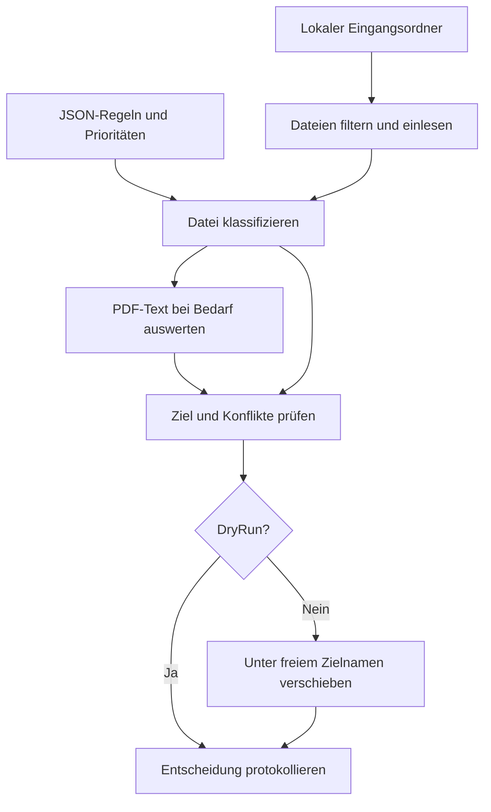

# Architektur und technische Entscheidungen

SmartSort verarbeitet lokale Dateien als Batch in einer .NET-10-Konsolenanwendung.

## Komponenten

| Bereich | Aufgabe |
|---|---|
| `SmartSorter/Program.cs` | Zusammensetzen der Komponenten, Konfiguration, Abbruchbehandlung und Exit-Codes |
| `App/Configuration` | Settings und Regeln; frühe Prüfung fehlerhafter Einstellungen |
| `App/Processing` | Verarbeitung eines Dokuments, DryRun und Zusammenfassung des Batch-Laufs |
| `Core` | Klassifizierung und Auswahl einer Zielkategorie ohne physische Dateioperationen |
| `Core/Documents` | Dokumentinformationen und verzögertes Öffnen des Datenstroms |
| `Core/Extraction` | Schnittstelle und Kombination von Text-Extraktoren |
| `Infrastructure` | Lokaler Dateisystemzugriff, Pfadsicherheit, Konfigurationsladung und PDF-Adapter |
| `Logging` | Serilog-Konfiguration |
| `SmartSorter.Tests` | Regeln, Konfiguration, Extraktion sowie Fehler- und Integrationstests |

## Verarbeitung

1. Konfiguration und Regeldatei einlesen und validieren.
2. Eingangsordner rekursiv scannen und Dateigrößen/-typen gemäß Konfiguration filtern.
3. Datei in ein `DocumentInput` mit verzögertem Stream-Zugriff überführen.
4. Die `RuleEngine` prüft zuerst günstige Kriterien (Dateiendung, Dateiname); PDF-Text wird nur bei Bedarf gelesen.
5. `FileClassifier` bestimmt die Kategorie einschließlich der Standardkategorien.
6. `DocumentProcessor` validiert Zielpfade und simuliert die Aktion oder führt sie aus.
7. `ProcessingResult` und die Batch-Zusammenfassung machen Erfolg und Fehler explizit.

## Designentscheidungen

- **Ein lokaler Prozess:** Die Klassifizierung entscheidet über das Ziel. Der Dateisystemcode führt den geprüften Plan aus.
- **Interfaces dort, wo sie helfen:** `IDocumentTextExtractor` kapselt PDF-Verarbeitung; `System.IO.Abstractions` ermöglicht simulierte Dateisysteme in Tests.
- **Deterministische Regeln:** Priorität zuerst, bei Gleichstand feste Sortierung nach Regelname.
- **DryRun als Standard:** Aktionen vor einem echten Verschieben nachvollziehen; standardmäßig keine Schreiboperationen auf Zieldateien.
- **Konflikte ohne Überschreiben:** Bei gleichem Dateinamen wird ein nummerierter Zielname gesucht; konkurrierende Schreibzugriffe werden berücksichtigt.
- **Schmale Ergebnismodelle:** Klassifizierung, extrahierter Inhalt und tatsächliche Dateioperation werden getrennt.
- **Betriebslogs statt Inhaltsablage:** Textinhalte von PDF-Dokumenten werden nicht in die strukturierten Logs übernommen; Dateinamen/Pfade können dennoch sensible Informationen enthalten.

## Grenzen

SmartSort verarbeitet einen lokalen Batch. Scans ohne Textebene benötigen OCR außerhalb der Anwendung. Verwende vertrauenswürdige Ordner und PDFs. Der PDF-Parser läuft ohne Sandbox. Bei gleichzeitig veränderten Ordnern können sich Pfade nach der Prüfung ändern.

Siehe [SECURITY.md](../SECURITY.md) für die ausführlichen Einschränkungen.

## Testen

Die [Startanleitung](../README.md#mit-beispieldateien-ausprobieren) enthält die Befehle für Restore, Build und Tests. Die CI führt die Prüfungen auf Windows und Ubuntu aus.

## Datenfluss

